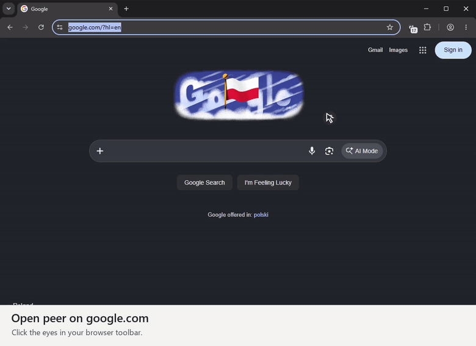

# peer

Open peer on a website to see which tracking services it contacted. Expand a company to inspect the matching request rule, or allow an endpoint on that site if something breaks. Blocking and link cleanup run in your browser.

[](https://github.com/crocs/peer/releases/download/v0.6.0/peer-guide.mp4)

[Watch the walkthrough on google.com (MP4)](https://github.com/crocs/peer/releases/download/v0.6.0/peer-guide.mp4)

## Install

**Windows setup.** Download the [Windows installer](https://github.com/crocs/peer/releases/download/v0.6.0/peer-0.6.0-windows-setup.exe) and choose your browser. Setup unpacks the files in your user folder. On the last screen, copy the path and open the browser. Chrome and Edge ask you to enable **Developer mode** and select **Load unpacked** once. When updating a copy installed from the same folder, click **Reload** on peer.

**Manual install.** Download the archive for your browser.

| Browser | Installation |
| --- | --- |
| [Chrome ZIP](https://github.com/crocs/peer/releases/download/v0.6.0/peer-0.6.0-chrome.zip) · 128+ | Extract the archive. Open `chrome://extensions`, enable **Developer mode**, and choose **Load unpacked**. Select the folder containing `manifest.json`. |
| [Edge ZIP](https://github.com/crocs/peer/releases/download/v0.6.0/peer-0.6.0-edge.zip) · 128+ | Extract the archive and follow the same steps at `edge://extensions`. |
| [Firefox / LibreWolf ZIP](https://github.com/crocs/peer/releases/download/v0.6.0/peer-0.6.0-firefox.zip) · desktop 140+ | Open `about:debugging#/runtime/this-firefox`, choose **Load Temporary Add-on**, and select the ZIP directly. This preview lasts until the browser restarts. Permanent installation requires a Mozilla-signed build. |

Pin peer to the toolbar and reload any sites that were already open.

## Use

| Feature   | Behavior                                           |
| --------- | -------------------------------------------------- |
| See       | Identify known tracking services. Always on.       |
| Block     | Block requests matching the bundled tracker lists. |
| Peer back | Remove tracking parameters from links you follow.  |

Features work together. Block and Peer back have independent switches; both are enabled on a new installation. **Enable all** turns them on together. Existing settings are preserved when upgrading.

Expand a company to see its latest detected endpoint and which list matched. For a URL rule, peer displays the bundled filter pattern. Browsing paths and query values are kept out of the example.

If a feature breaks, expand a company, find the endpoint, and choose **Allow here**. Reload the page to retry. The exception covers requests from that site and its subdomains to the selected endpoint and its subdomains. Remove an exception from the same row or in Settings. You can also pause protection for the whole site.

Peer back skips signed links and common login and payment paths.

The interface starts in English. Choose Russian in **Settings → Language**. Optional features include an on-page eyes indicator and seven-day local history.

## Privacy and coverage

Request matching runs locally. There is no account, server, or telemetry. History and the on-page indicator are off by default. History stores hostnames and company counts on your device and can be deleted in Settings.

peer checks domains and request patterns from EasyPrivacy. For example, a request to `/matomo.php` can match on a website outside the domain list. Rules can depend on resource type, the site making the request, and whether the destination is third-party. Compatibility exceptions take precedence. General domain blocks apply to third-party resources.

A separate list covers **40,178 known tracking aliases** from 16 analytics and advertising providers in AdGuard’s CNAME data. These can match on a site’s own subdomain. The extension makes no DNS lookups. The combined lists contain 72,888 distinct domain entries, plus 8,458 contextual filters and 854 compatibility exceptions. Cosmetic filters, redirects, and script injection are outside the network filter set.

Protection applies across ordinary HTTP and HTTPS websites where the extension has access. Browsers restrict access to internal pages and their extension stores. First-party and server-side tracking may not be covered.

Known operators are grouped by company. Unattributed endpoints appear under **Other trackers**, without guessing their owner. Company descriptions explain what a service can collect; they do not reveal the contents of a particular request or a company’s advertising profile.

Chrome and Edge can show confirmed blocking actions after you open peer from the toolbar. Firefox shows the requests peer detected on the page. Blocking and site exceptions use the browser’s native network rules in all three builds. Peer back does not change your IP address or browser fingerprint.

Brand artwork ships with the extension. Chrome and Edge use the browser’s local site icons. Firefox displays a globe for the site. The full privacy policy is under **Settings → Privacy policy**.

## Build

Node.js 24 or newer.

```sh
npm ci
npm run build
```

Load `.output/chrome-mv3` as an unpacked extension. Use `npm run build:edge` or `npm run build:firefox` for the other browsers. `npm run zip` builds all three archives in `.output/`.

To reproduce the Firefox submission, extract the source archive, run `npm ci` and `npm run build:firefox`, and compare `.output/firefox-mv3` with the contents of the Firefox ZIP. From a clean release checkout, `npm run zip:source` packages the committed source. On Windows, run `npm run setup:windows` after `npm run zip` with Inno Setup 7 on PATH or set `ISCC` to the compiler executable.

Filter data is pinned in the repository. Run `npm run update:filters` to refresh EasyPrivacy and the selected AdGuard lists, then `npm run build` to compile them. Installed copies receive filter changes with new releases.

## License

Application code is licensed under [MIT](LICENSE). EasyPrivacy data and derived rules are attributed to the EasyList authors under [CC BY-SA 3.0](data/LICENSE.txt). AdGuard’s tracking alias data uses the [MIT license](data/adguard-LICENSE.txt). Brand assets retain their respective rights and source notices.
